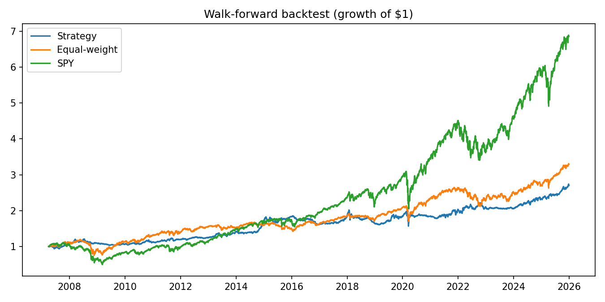

# Alpha Lab

A Python toolkit for turning investment signals into position sizes, and for testing whether those signals would have worked.

- **`institutional_alpha_lab.py`**: interactive Streamlit dashboard. Pick assets, set or compute signals, and get optimal weights, risk metrics, a walk-forward backtest and a Monte Carlo risk simulation.
- **`backtest.py`**: command-line walk-forward backtest that produces the results below.

## How it works

1. **Signal.** Each asset gets a z-score from -3 to +3. By default this is a **time-series momentum (trend)** signal: the asset's 12-month return, skipping the most recent month, divided by its volatility. The signal is computed from prices only and is never set by hand.
2. **Expected return.** The signal is converted with Grinold's Fundamental Law alpha model: `mu = IC x volatility x z`.
3. **Sizing.** Mean-variance optimal weights, `w = k * Sigma^-1 mu`, scaled by a **fractional Kelly** factor `k` and capped at a maximum gross exposure. The covariance matrix is shrunk toward its diagonal for stability.
4. **Risk.** Ex-ante volatility and Sharpe, a correlation matrix, diversification benefit, a 95% parametric VaR and a 5,000-path Monte Carlo of one-year returns.

## Backtest results

The universe is fixed in advance at eight ETFs covering the major asset classes: US stocks (SPY), developed international (EFA), emerging markets (EEM), 7-10y Treasuries (IEF), 20y+ Treasuries (TLT), gold (GLD), commodities (DBC) and US REITs (VNQ). The strategy rebalances monthly and pays 10 bps per unit of turnover. Each rebalance uses only data available on that date.

| 2007-2025            | Strategy | Equal-weight | S&P 500 (SPY) |
|----------------------|---------:|-------------:|--------------:|
| Annualized return    | 5.3%     | 6.6%         | 10.8%         |
| Annualized volatility| 8.5%     | 12.7%        | 19.8%         |
| **Sharpe ratio**     | **0.65** | 0.56         | 0.62          |
| Max drawdown         | **-21.9%** | -37.0%     | -55.2%        |

**Out of sample (2013-2025).** Trend following across asset classes was documented by Moskowitz, Ooi & Pedersen (2012), so data from 2013 onward is a genuine out-of-sample test. Over that period the strategy's Sharpe was 0.70, against 0.64 for equal-weight and 0.90 for the S&P 500, which had an exceptionally strong run.

Correlation to the S&P 500 was 0.22. Average monthly turnover was 39%.



## Limitations

- **The 95% parametric VaR was breached 6.9% of the time against a 5% target.** Normal-distribution VaR understates tail risk for this mix of assets. Historical or Student-t VaR is the next step.
- **The results come from a single run with default parameters chosen in advance.** I did not tune any parameters to the data.
- **Annualized returns are lower than the S&P 500's.** The strategy is designed for risk-adjusted return and drawdown control, and it runs at less than half the S&P's volatility.

## Run it

```bash
pip install -r requirements.txt

python backtest.py                      # trend strategy (default)
python backtest.py --strategy sector    # cross-sectional sector momentum, for comparison
python backtest.py --cost-bps 20        # other options: --ic --kelly --gross-cap --start --end --split

streamlit run institutional_alpha_lab.py   # opens the dashboard in your browser
```
